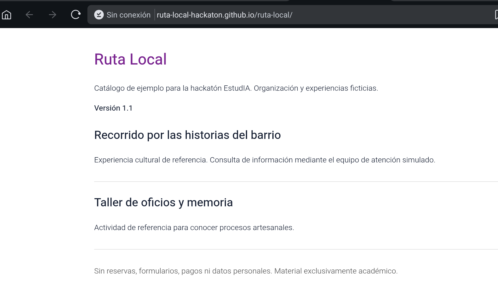
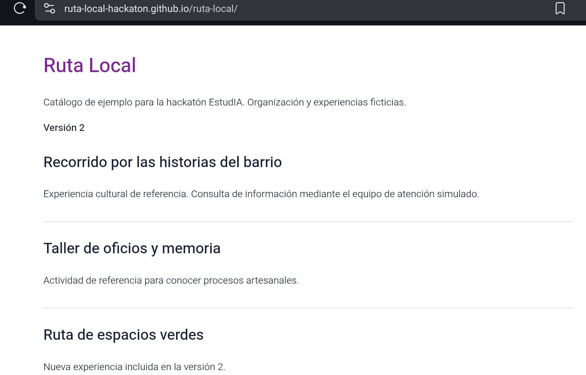
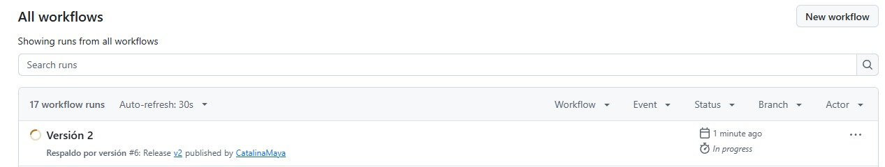
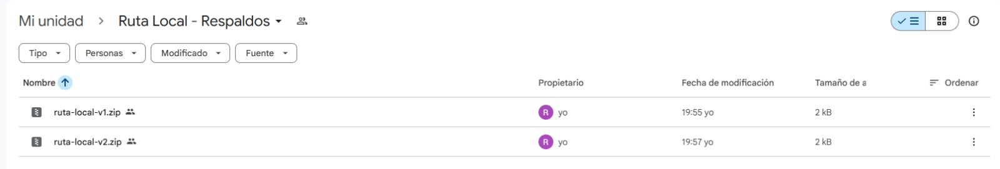
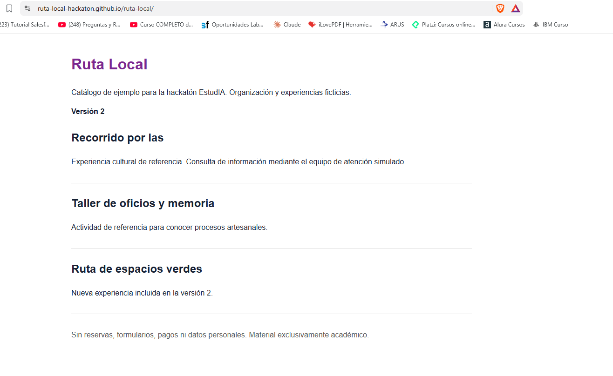
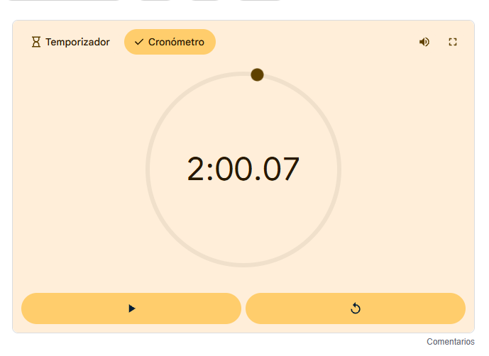
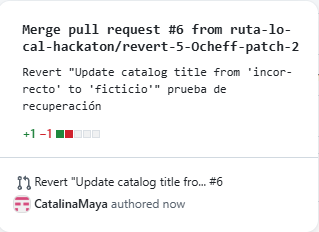
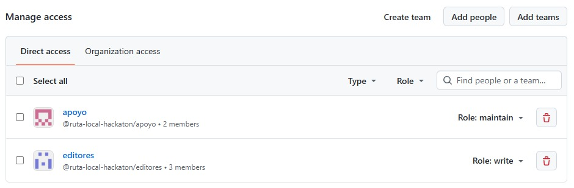

# Registro de evidencias — Equipo Cloudy

Caso Ruta Local · EstudIA · Nube e infraestructura · Nivel básico

## Registro del equipo

Equipo: Cloudy

Integrantes y responsabilidades:

- Jahleel Areiza: Comunicador. Documentador: también aprueba cambios.
- Matteo Rodríguez: Diseñador
- Catalina Maya: Coordinadora. Owner de la organización y code owner.
- Diego Ardila Sanchez: Investigador

Fecha: 21 de noviembre de 2026

Modalidad: Nube (GitHub Pages)

Dirección del sitio y versión: https://ruta-local-hackaton.github.io/ruta-local/ — versión 2 (release v2)

Arquitectura elegida y motivo: Alojamiento en GitHub (GitHub Pages), debido a la facilidad de uso, buen control de versiones y control de permisos. Flujo: pull request → validación automática (GitHub Actions) → aprobación de un responsable de revisión → autorización del despliegue → GitHub Pages. Cada release genera un .zip que se copia a Google Drive.

Ayudas utilizadas y cambios realizados: No se registra el uso de scripts/herramientas.py [confirmar]. Cambios propios: workflows de GitHub Actions (validar, construir y publicar, respaldo por versión), ruleset sobre main, archivo CODEOWNERS, environment github-pages con aprobación, 2FA obligatorio y copia automática a Drive.

Recursos, permisos y posibles costos:

- Lectura: visitantes y aliados, sin cuenta, en la URL pública.
- Actualización: equipo editores (rol Write); proponen cambios mediante pull request.
- Revisión y aprobación: equipo apoyo (rol Maintain) y coordinación.
- Administración: Catalina Maya, owner de la organización: aprueba, publica, crea releases, restaura y administra la configuración y los permisos.
- Respaldo: GitHub Releases: versiones oficiales v1 y v2.
- Respaldo: Google Drive: carpeta «Ruta Local - Respaldos», en una cuenta dedicada al reto (rutalocalestudia@gmail.com). La coordinación tiene acceso de lector y la credencial de escritura está guardada como Secret de GitHub.
- Costos: $0: repositorio público, publicación y automatización en planes gratuitos, sin dominio propio. Podrían generar consumo el almacenamiento, la transferencia, las solicitudes y un dominio propio, que sería el primer costo. No se contrató ningún recurso.

## Resumen de pruebas

| ID | Prueba | ¿Cumple? |
| --- | --- | --- |
| B01 | Publicación | Cumple |
| B02 | Actualización | Cumple |
| B03 | Respaldo | Cumple |
| B04 | Recuperación | Cumple |
| B05 | Permisos | Cumple |
| B06 | Repetibilidad | Cumple (evidencia por adjuntar) |

## Ficha B01 — Publicación

- **ID y nombre de la prueba:** B01 — Publicación

- **Qué queremos comprobar:** Abrir la dirección pública y reconocer la versión inicial y sus estilos.

- **Versión y estado inicial:** Repositorio con la versión 1 (release v1). El sitio muestra «Versión 1.1», que corresponde a la versión 1 del paquete.

**Pasos para repetirla**

1. Abrir https://ruta-local-hackaton.github.io/ruta-local/ en una ventana privada.
2. Comprobar que aparece «Versión 1.1», el catálogo y los estilos.

- **Resultado esperado:** El catálogo de la versión 1 carga con sus estilos y por HTTPS desde GitHub Pages.

- **Resultado observado:** Cargó «Ruta Local — Versión 1.1» con «Recorrido por las historias del barrio» y «Taller de oficios y memoria», con estilos.

- **Inicio, fin y duración:** No aplica.

- **Archivo, captura o enlace de evidencia:** Capturas incluidas a continuación.

- **¿Cumple? Sí / No / Parcial / No realizado:** Sí

- **Error encontrado y ajuste:** Ninguno registrado.

- **Resultado al repetir la prueba:** No registrado.

Figura 1. Sitio publicado en GitHub Pages mostrando «Versión 1.1».

## Ficha B02 — Actualización

- **ID y nombre de la prueba:** B02 — Actualización

- **Qué queremos comprobar:** Publicar la versión 2 y comprobar el nuevo contenido.

- **Versión y estado inicial:** Sitio publicado en la versión 1 (Versión 1.1).

**Pasos para repetirla**

1. Un editor abre un pull request con los archivos de la versión 2.
2. El workflow «validar» revisa el HTML y los enlaces.
3. Un responsable de revisión (apoyo o coordinación) aprueba y hace merge.
4. La coordinadora autoriza el despliegue en el environment github-pages.
5. La coordinadora publica el release v2.
6. Abrir la URL, recargar y comprobar el contenido.

- **Resultado esperado:** Aparecen «Versión 2» y la nueva experiencia «Ruta de espacios verdes».

- **Resultado observado:** Aparecen «Versión 2» y «Ruta de espacios verdes — Nueva experiencia incluida en la versión 2».

- **Inicio, fin y duración:** No registrado.

- **Archivo, captura o enlace de evidencia:** Capturas incluidas a continuación.

- **¿Cumple? Sí / No / Parcial / No realizado:** Sí

- **Error encontrado y ajuste:** El workflow «validar» no falló. Durante la construcción, la publicación fallaba: se separó la automatización en dos trabajos (construir y publicar) y quedó estable.

- **Resultado al repetir la prueba:** No registrado.

Figura 2. Versión 2 publicada, con la nueva experiencia «Ruta de espacios verdes».

## Ficha B03 — Respaldo

- **ID y nombre de la prueba:** B03 — Respaldo

- **Qué queremos comprobar:** Identificar la ubicación, la versión y los archivos incluidos en el respaldo.

- **Versión y estado inicial:** Releases v1 y v2 publicados en GitHub.

**Pasos para repetirla**

1. La coordinadora publica un release (tag vX).
2. Se ejecuta automáticamente el workflow «Respaldo por versión».
3. Verificar en GitHub Actions que terminó.
4. Abrir la carpeta de Drive «Ruta Local - Respaldos» y confirmar el archivo ruta-local-vX.zip.

- **Resultado esperado:** Un .zip por cada versión oficial, guardado en Drive, fuera de GitHub.

- **Resultado observado:** ruta-local-v1.zip (19:55) y ruta-local-v2.zip (19:57), 2 kB cada uno. Run «Respaldo por versión #6» del release v2, publicado por CatalinaMaya.

- **Inicio, fin y duración:** No registrado.

- **Archivo, captura o enlace de evidencia:** Capturas incluidas a continuación.

- **¿Cumple? Sí / No / Parcial / No realizado:** Sí

- **Error encontrado y ajuste:** La credencial del respaldo venció una vez y se restauró en minutos. Mejora prevista: un permiso propio para el respaldo y un aviso si algo falla.

- **Resultado al repetir la prueba:** No registrado.

Figura 3. Workflow «Respaldo por versión #6», lanzado por el release v2 publicado por CatalinaMaya.

Figura 4. Carpeta de Drive «Ruta Local - Respaldos» con ruta-local-v1.zip y ruta-local-v2.zip.

## Ficha B04 — Recuperación

- **ID y nombre de la prueba:** B04 — Recuperación

- **Qué queremos comprobar:** Provocar un error en el entorno de prueba, recuperar el contenido esperado y medir el tiempo.

- **Versión y estado inicial:** Sitio publicado en la versión 2.

**Pasos para repetirla**

1. Mediante un pull request, introducir el error: título «Catálogo incorrecto» y borrado de parte del texto.
2. Comprobar el error en la URL pública.
3. En GitHub Actions, ejecutar Run workflow con el tag v2 (última versión aprobada y publicada).
4. La coordinadora autoriza el despliegue.
5. Recargar la URL y confirmar la versión 2 completa.
6. Revertir el pull request del error (el PR #6 revierte el PR #5) para que main quede sin el error.
7. Medir con cronómetro cada método de recuperación.

- **Resultado esperado:** Vuelve la versión 2 completa, con el catálogo y los estilos.

- **Resultado observado:** Se recuperó la versión 2 completa con ambos métodos.

- **Inicio, fin y duración:** Horas de inicio y fin no registradas. Duración: 2 minutos con cada método (cronómetro 2:00.07).

- **Archivo, captura o enlace de evidencia:** Capturas incluidas a continuación.

- **¿Cumple? Sí / No / Parcial / No realizado:** Sí

- **Error encontrado y ajuste:** Ninguno durante la recuperación.

- **Resultado al repetir la prueba:** No registrado.

Figura 5. Sitio con el error: texto incompleto («Recorrido por las»).

Figura 6. Tiempo de recuperación medido: 2:00.07.

Figura 7. Merge del PR #6, que revierte el cambio con el error.

## Ficha B05 — Permisos

- **ID y nombre de la prueba:** B05 — Permisos

- **Qué queremos comprobar:** Demostrar la diferencia entre lectura, actualización y administración.

- **Versión y estado inicial:** Organización ruta-local-hackaton con equipos apoyo (Maintain) y editores (Write), ruleset en main, CODEOWNERS, environment github-pages y 2FA obligatorio.

**Pasos para repetirla**

1. Abrir la URL sin iniciar sesión (ventana privada): se consulta, pero no se puede editar.
2. Con una cuenta del equipo editores, intentar aprobar un pull request y hacer merge.
3. Con la cuenta de la coordinadora, aprobar y autorizar el despliegue.

- **Resultado esperado:** Lectura sin cuenta. El editor propone, pero no aprueba ni publica. Solo los responsables de revisión aprueban.

- **Resultado observado:** El editor no pudo aprobar ni hacer merge.

- **Inicio, fin y duración:** No aplica.

- **Archivo, captura o enlace de evidencia:** Capturas incluidas a continuación.

- **¿Cumple? Sí / No / Parcial / No realizado:** Sí

- **Error encontrado y ajuste:** Al probar, cualquier editor podía aprobar el cambio de otro. Se corrigió con CODEOWNERS: ahora solo cuenta la aprobación de los responsables de revisión.

- **Resultado al repetir la prueba:** No registrado.

Figura 8. Equipos del repositorio: apoyo (rol Maintain, 2 miembros) y editores (rol Write, 3 miembros).

## Ficha B06 — Repetibilidad

- **ID y nombre de la prueba:** B06 — Repetibilidad

- **Qué queremos comprobar:** Otro integrante repite la recuperación siguiendo las instrucciones del equipo.

- **Versión y estado inicial:** [completar]

**Pasos para repetirla**

1. Seguir el Manual de usuario Cloudy (v1.0), tarea 4.1 «Volver a una versión anterior».

- **Resultado esperado:** Otro integrante recupera el sitio sin ayuda de quien lo configuró.

- **Resultado observado:** Otro integrante repitió la recuperación sin problemas. Integrante: [completar].

- **Inicio, fin y duración:** [completar]

- **Archivo, captura o enlace de evidencia:** [pendiente]

- **¿Cumple? Sí / No / Parcial / No realizado:** Sí (evidencia por adjuntar)

- **Error encontrado y ajuste:** Ninguno reportado.

- **Resultado al repetir la prueba:** [completar]

Sin captura todavía: adjuntar evidencia de la repetición (integrante, duración, pantallazo).

## Cierre

Qué funciona realmente:

- Publicación en GitHub Pages con HTTPS, en una URL estable.
- Actualización por pull request, con validación automática y aprobación obligatoria.
- Respaldo automático a Drive en cada release.
- Recuperación en 2 minutos con dos métodos: Run workflow con el tag v2 y revert del pull request.
- Permisos aplicados por reglas: un editor no puede aprobar ni hacer merge.

Qué quedó como propuesta o pendiente:

- Aún depende de una persona: decidir cuándo una versión es oficial, autorizar cada publicación y renovar la llave del respaldo cuando vence.
- Plan ante una falla del alojamiento: está propuesto (publicar el .zip de Drive en otro alojamiento estático), pero no se ha probado.
- Registrar las horas de inicio y fin de las pruebas.
- Evidencia de B06 y captura del intento bloqueado de un editor (B05).
- Manual de usuario: completar las capturas y ajustar los ejemplos al catálogo publicado.

Procedimiento para recrear y recuperar: Publicar o actualizar: pull request → validar → aprobación → autorización del despliegue → release. Recuperar: Run workflow con el tag de la última versión buena + revert del pull request con el error. Respaldo independiente: Drive «Ruta Local - Respaldos».

Limitaciones y cambios para el encuentro 3:

- Ajuste ya hecho: Cualquier editor podía aprobar → ahora solo cuenta la aprobación de los responsables de revisión (CODEOWNERS).
- Ajuste ya hecho: La publicación fallaba → la automatización se separó en dos trabajos, construir y publicar, y quedó estable.
- Ajuste ya hecho: El respaldo dependía de alguien → el .zip de cada versión se copia solo a Drive, con la llave cifrada como Secret.
- Mejora priorizada: Un permiso propio para el respaldo y un aviso si algo falla.
